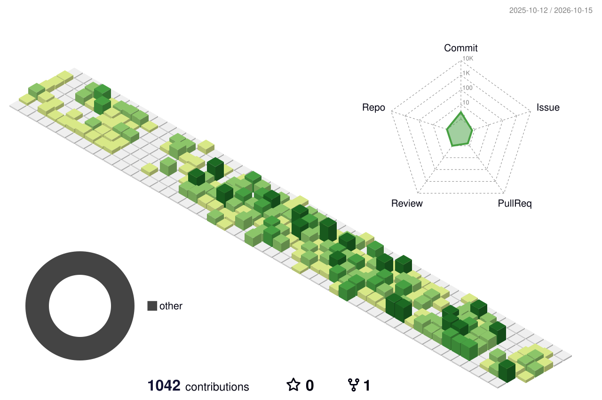
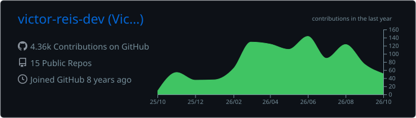
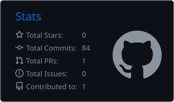
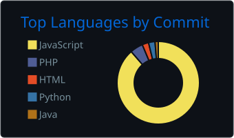

<h1 align="center">👋 Hi, I'm Victor Reis</h1>
<h3 align="center">Full Stack Developer focused on building practical web systems, automations and real solutions</h3>

  
  
  
  

---

## About me

- 🧑‍💻 Full Stack Developer with **5+ years** building systems that run real business operations: back-office platforms, e-commerces, dashboards and API integrations.
- 🐘 Backend by preference — **PHP + Laravel** at the core — with a focus on clean APIs, sound architecture and code that stays maintainable as it grows.
- 🎓 Bachelor's degree in Information Systems.
- 🔭 Beyond the day job: experimenting with AI agents, self-hosted infrastructure and developer tools.

## Contribution graph

*My contribution calendar in 3D — updated daily by GitHub Actions.*

## GitHub stats

  

  
  

## Tech stack

**Languages & Runtimes**

  
  
  
  
  
  
  

**Frameworks & Libraries**

  
  
  
  
  
  

**Databases & Realtime**

  
  
  
  

**Infra & Cloud**

  
  
  
  
  

**Tools & Quality**

  
  
  
  
  
  

## Get in touch

  
  
  

